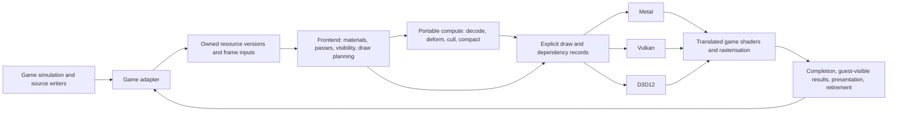

# Frontend architecture

This page records the design the user approved on November 1, 2026 for the portable Rust
rendering frontend, and the direction later measurements set for it. It describes our own
architecture. What the frontend must reproduce is specified in [behavior/](behavior/README.md);
how its replacement of original work is proven and accepted is in [acceptance.md](acceptance.md);
how the adapter's Main path works today is in [design/](design/README.md) once those notes land.

## Outcome and scope

The frontend replaces the game's render-only preparation with a Rust implementation that consumes
scene inputs before the original preparation starts. It removes the targeted PPU preparation, the
render SPU jobs and their children, the intermediate geometry and command production, and the
transport between them. It keeps correct appearance, gameplay-visible outputs and completion
order, and it reuses the game's translated shaders and the GPU rasterisation where they are
correct.

The target is sustained 60 newly rendered frames per second in representative real multiplayer
matches, on declared reference hardware for each of macOS, Windows and Linux. A Training
demonstration, a repeated presentation of an old frame, generated or interpolated frames, or a
kernel benchmark does not meet it. Faster rendering must not speed up simulation, animation,
network timers or input.

**In scope:** Main, DepthNormal, every Shadow occurrence, Other, the render-only scene traversal,
visibility, occlusion and level of detail, sorting, material, constant and state preparation,
geometry decoding and deformation, render-only particles and lights, auxiliary views, transparent
and effect passes, and the UI and post-processing preparation that belongs to rendering.
Rendering families not yet identified remain open scope; the inventory, not a module's name,
decides what a producer is for.

**Out of scope:** gameplay, physics, AI, networking, authoritative scene ownership, streaming I/O,
and animation results that gameplay needs. Work with mixed purposes is split by its observable
outputs; simulation is never disabled to gain frame rate.

## Direction and rejected alternatives

The chosen direction is a new semantic frontend in Rust, portable compute kernels, and thin
adapters to the existing Metal, Vulkan and D3D12 devices. Rejected as the final architecture:

1. **Widening the per-job adapter.** It keeps the original upstream preparation and the state
   inherited from it, and it only ever covered a small share of the geometry.
2. **Translating every SPU instruction into GPU work.** That carries the original scheduling,
   local-store and transport structure into the replacement instead of removing it.
3. **Replacing shader translation and every platform renderer at once.** That widens the scope
   without addressing the measured costs. A backend is repaired or extended only where this
   design needs it.

Running some of the work natively on the CPU is an implementation choice inside the frontend, not
a separate architecture: small or irregular work can stay in Rust, and bulk work whose consumers
are on the GPU should stay on the GPU. CPU code consumes semantic inputs directly and never calls
original SPU preparation.

## Layers

Rust owns scene translation, resource generations and leases, material evaluation, pass planning,
visibility policy, geometry scheduling, draw records, completion state and accounting. New code is
safe Rust except at isolated guest-memory and FFI boundaries. CPU workers may run in parallel on
owned, immutable inputs; GPU encoding stays with one explicit backend owner.

| Crate or file | Role |
| --- | --- |
| `crates/mag-render` | Owned types, resource store, scene and pass records, lifecycle, accounting and the C ABI |
| `crates/mag-render-abi` | C-compatible transport types |
| `crates/mag-render-shaders`, `shaders/` | Build-time translation of portable WGSL compute kernels (pinned Naga) to MSL, HLSL and SPIR-V |
| `crates/mag-render-programs` | Compiling the game's own programs into native stages |
| `crates/mag-render-native` | Metal, Vulkan and D3D12 encoders on a borrowed host device, and the native worker |
| `crates/mag-render-behavior` | The clean-room behaviour rules from [behavior/](behavior/README.md) |
| `crates/mag-render-adapter-core`, `-scene`, `-link`, `crates/mag-render-behavior-glue` | The game adapter's publishable parts and their link into the client |
| `cmake/MagRender*.cmake`, `.github/workflows/render-frontend.yml` | Opt-in builds and three-OS checks |

The parts of the adapter that are not yet publishable stay in a separate checkout until they are
re-specified under [the reimplementation method](../native-graphics-reimplementation-method.md)
(see [render-frontend.md](../render-frontend.md#game-adapter)).

**One device per backend.** While the original renderer still owns presentation, the runtime lends
the frontend its existing device and queue through explicit lifetime and ordering leases. Raw
handles cannot certify that original command recording is clean. Once the frontend owns the whole
presentation path it may create the device itself and lend it to a temporary 2D path for the
HUD, menus and text. There is never a second GPU runtime or a per-frame copy between devices.
New buffer, pipeline, command encoding and completion code belongs with the frontend, not in a
growing rendering layer inside the runtime.

**Portable first.** The frontend starts with ordinary storage buffers, indexed and instanced draws,
compute and indirect arguments. It does not require mesh shaders, bindless resources, a subgroup
width or unified memory; any backend-specific optimisation has equivalent portable behaviour. A
missing required capability is a visible error, and a platform cannot pass acceptance on a null or
software backend. Windows players currently use the Vulkan backend; the D3D12 backend is kept and
checked but is not the player route.

## Contracts

- **Frame identity** (`FrameIdentity`): a monotonic render transaction with its source and camera
  publications. The world update it belongs to is recorded separately (`WorldUpdateId`), so the
  original simulation and network rates are kept. Incrementing a counter does not prove new work.
- **Resource identity** (`ResourceId { slot, generation }`, `ResourceVersion`): an owned identity
  plus a content version. A guest address alone is never an identity. Asynchronous reads are
  protected by an immutable snapshot or by a lease on a proven writer.
- **Frame input:** views, objects, transforms and palettes, lights, effect inputs, material
  changes, a stable source order, resource references and explicit readiness. It never needs the
  original's expanded vertices, job-local state or prepared command packets.
- **Material record:** shader structure and layout, textures and samplers, render state, role and
  variant, constants and version. Nothing is implicitly inherited from a previous original draw.
- **Pass plan:** occurrence identity, view, attachments, load and store rules, dependencies,
  ordered draw and compute records, and external results. Multiple shadow and auxiliary views are
  first-class.
- **Prepared frame:** owns its resource leases and validated plans before any external effect is
  committed.
- **Submission ticket:** backend generation, a monotonic submission identity and a pending,
  completed or failed state.
- **External result:** a named consumer, its required ordering, its payload and the real
  condition that makes it ready. Source consumed, guest publication, GPU completion, presentation
  and resource retirement are separate events.

Across the C boundary, records are `repr(C)`, tagged with version and size, and use fixed-width
values, opaque owned handles, explicit buffer lengths and status codes. No Rust `Vec`, enum
layout, reference or unwinding crosses it. Borrowed caller memory is consumed synchronously or
copied before the call returns. Exactly one owner destroys each handle, and callbacks are
generation-checked and thread-affine.

## Transactions, cutover and fallback

A transaction moves through observed, prepared, committed, submitted, completed and retired, with
an explicit decline before commit and an explicit failure after it.

- **Admission** checks capability, input readiness and output reservations before any original
  work is suppressed.
- **Before commit,** the transaction may decline, and the original work runs for that complete,
  dependency-consistent unit. Passes that share effects cut over together.
- **After commit,** the original subtree is never replayed. A submit or device failure is a
  failure, not permission to fabricate a guest-visible completion.
- **Decline instead of guessing.** Unknown writers, invalid ranges, unsupported formats, a target
  that does not match exactly, or unresolved state decline the unit and count the reason. There is
  no fallback to "the newest target", "the last presented image", a default format or a zero.
- **No routine readback** between compute and draws. Diagnostic colour and depth readback is
  opt-in and outside throughput windows; readback that gameplay or queries really need stays
  explicit and measured.

During development the original path stays available as an explicit mode. Final acceptance
requires zero fallback in the normal workload; valid content the frontend cannot yet handle is
missing coverage, not a reason to shrink the inventory.

## Source ownership in the adapter

The adapter turns guest memory into owned sources. Its rules:

- **Copy or hold a lease.** Data read at a borrowed boundary is copied before the boundary returns,
  or read under a lease on a writer that is proven not to change it. Without either, the read
  declines.
- **Identity is not an address.** Pointer equality, allocation identity or a callback firing does
  not prove that a source is ready or unchanged. Cross-frame reuse is keyed by an owned content
  identity, or by allocation, publication and retirement events, never by guest address or an
  update counter.
- **The guest write watch** (`PS3RECOMP_VM_WRITE_WATCH=1` in the runtime) lets the adapter keep a
  copy of guest memory and learn that it has not been written since it last looked, without
  reading it again. A span the watch cannot vouch for is read again.
- **Claims and revocation.** A source is claimed by the transaction that consumes it. A definite
  refusal leaves it valid for the next attempt; an accepted or indeterminate hand-off consumes it.
  A real source failure or a VM change revokes every retained source. A capacity refusal declines
  only the new capture and is counted separately from an invalid source.
- **Explicit obligations.** Anything not yet proven (a writer lifetime, a field's meaning, an
  unclosed consumer) stays attached to the source as an open obligation and blocks any claim that
  depends on it; it is never silently assumed.

## Measured direction (November 2026)

Measurement rounds after the design changed the order of work, not the destination:

- **Compare against a fair original baseline.** An early comparison against an original renderer
  that still carried diagnostic capture overstated the gain. Once the original control ran with
  the same settings and no replacement-only work, the native path of that time was slower, and
  the reason was late, serial preparation on the RSX FIFO thread delaying shared progress. Later
  rounds beat that fair baseline on the Mac, in Training and in a hosted match. Every
  A/B since compares arms of one build in one round, and records where waits move as well as the
  total: a shorter wait in one place matched by a longer one elsewhere is not a gain.
- **Move work off the FIFO dependency.** Split preparation into immutable early work (decoding
  assets, preparing material variants, building geometry references, warming pipeline variants)
  and late binding at the FIFO boundary (inherited state that cannot be known earlier, exact image
  generations, ordering and the final commit). Inherited state is carried explicitly as upstream
  passes become native, never predicted by reading mutable RSX state early. The Main path's
  chunked planning, early completion and prepared plan are the current form of this
  (see [design/](design/README.md)).
- **Give resources persistent, versioned ownership.** Mesh, index, texture, material and program
  resources become native at their asset publication, with an allocation lifetime and a content
  version; per-update data (transforms, palettes, instances, material deltas, time, lights,
  effects) travels separately. A replaced asset revokes the old version while in-flight consumers
  keep it until completion. Until a resource class has writer coverage it keeps a counted snapshot
  fallback.
- **Connect Depth and Main.** Native Depth and Main share immutable geometry and the frame's
  deformation, with separate pass and material variants, and Main reads Depth's attachments
  through graph resource identity and ordering. A second, separate per-frame Depth pipeline would
  repeat the measured failure. Deformation is shared only where no pass-dependent term (for
  example a view-dependent fade that feeds later wind) makes the result differ per view.
- **Start the transaction earlier, then replace the producers upstream.** The adapter's Main path
  still consumes the cohort after the original visibility and sorting have run. The route to
  removing render-only traversal, culling and sorting is to start the transaction at the regular
  render phase and feed the same pass graph from camera, object, pose, material, light, effect and
  resource publications, keeping the CPU results gameplay needs as named outputs.
- **Optimise backend encoding last.** GPU throughput has not been the limit. Packed uploads,
  bounded frames in flight and the existing pipeline caches stay; a second graphics runtime, a
  bindless or mesh-shader redesign, wholesale indirect drawing or a deeper frame queue are not
  priorities. Making waits asynchronous without moving independent work earlier only hides a
  backlog.

The planned order of the remaining stages: the Main path's mechanisms into the adapter
crates (each default-off with synthetic tests); the clean-room producer stages one at a time
(specifications first, then implementations from them); the Depth cutover; and the native Shadow
pass last.
